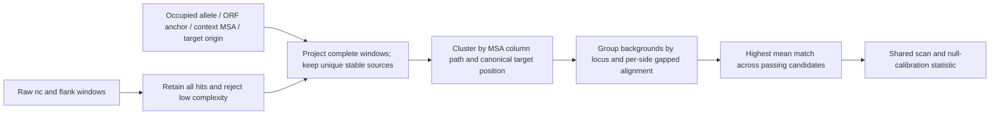

# Step 2 corpus evidence builder (implemented, 2026-10-11)

`scripts/build_v3_corpus_evidence.py` now generates sequence-bound evidence
directly from unpacked panel `loci.tsv` / `alleles.fna` files. Runtime:
NumPy, Biopython, and Pyrodigal (local run: Pyrodigal 3.7.1).

```bash
python scripts/build_v3_corpus_evidence.py \
  --jsonl adapted.jsonl --audit per_site_audit.final.tsv \
  --provenance-root /path/to/unpacked_provenance \
  --bag-list config/v3_sweep_cids.txt --outdir logs/v3_step2_evidence
python scripts/run_v3_scorer.py --jsonl adapted.jsonl \
  --evidence-manifest logs/v3_step2_evidence/verified_evidence.jsonl \
  --bag-ids "$(paste -sd, config/v3_sweep_cids.txt)" \
  --outdir logs/v3_step2_scan
```

The builder checks sources again, rather than trusting the audit's ready
label. It enumerates the entire deletion-boundary domain, retains every
globally minimum Hamming solution, checks the upstream equivalent-count,
and verifies the stored insert MD5 at an optimal boundary. Exact events
must reproduce the empty allele with zero mismatches. Tolerant events
are supported only when deleting `inserted_len` leaves the same length as
the empty allele. Indel/replacement cases and count disagreements stay
unresolved. The algorithm does not claim to reproduce a gapped upstream
decomposition objective.

Pyrodigal runs on occupied alleles. Only complete ORFs inside every valid
insertion interval can anchor an alignment. A family has a unique member
per participating site, >=95% protein identity and >=90% paired coverage
against one reference. Family assignment does not use transitive chains
or motif hits. The anchor with greatest site coverage, then longest
minimum protein length, is chosen before guide scoring.

The context MSA is an **anchor-split global star MSA**, not MAFFT. Left
context, anchor CDS, and right context align separately to one reference,
then insertion columns are merged. Every ungapped row exactly reproduces
its ORF-oriented occupied context. Segments >=30 bp need >=70% identity
and >=70% paired coverage; contexts above 10 kb remain unresolved. This
deterministic MSA remains a provisional evidence method: alternative
optimal gap placements are not exhaustively propagated into motif-column
uncertainty. Inspect repeat/indel-rich alignments before treating their
columns as biological conservation.

Target coordinates use `orf_oriented_empty_flank_midpoint_v1`: a unique,
exact 120-bp flank source in the empty allele, oriented by the same ORF.
The midpoint is the extraction frame; it does not resolve an ambiguous
biological insertion junction. Locus grouping now explicitly uses seed
reference genome/contig/start/end. Seed-locus coordinates are never paired
with a different pre-event carrier's genome identifier.

Outputs: `verified_evidence.jsonl`, `site_status.tsv`, `bag_status.json`,
per-bag context MSA, alignment-quality metrics and anchor proteins. Missing
sites preserve the original K denominator and prevent a complete-bag call.

Real pilot: CDS03597 has eight mapped sites. Its known nc1/L14 window maps
to MSA columns [131,145) at site 0, [1917,1931) at site 4,
[1852,1866) at site 6 and [1875,1889) at site 7. Sites 4/7 fail full-window
boundary stability. The old four-support perfect-match cluster no longer
survives; the bag's maximum passing mean match is 0.7777777778, uncalibrated.
CDS00113 remains incomplete because two sites require indel-aware boundary
reconstruction. Seven builder regressions plus sixteen integration tests
pass, including the four real CDS03597 boundary counts.

The local full builder checked all 1173 bags / 8697 sites, emitting 1249
evidence records (1201 with unique fragment sources). Eight bags have
complete evidence. These counts
describe this conservative implementation, not biological negatives.
No new validated threshold is available: eight complete bags cannot meet
the calibration analyzer's default minimum train/holdout sample sizes.

The local input was reconstructed from the GitHub audit's exact selected
site IDs and the HF v5 records, preserving the legacy adapter's first two
nc fragments / 250-bp truncation and ambiguity sanitization. Its 1173-bag
scope has no conflicting raw source keys. This scan does not cover omitted
raw nc regions or recover a unique sequence for the two ambiguous source
keys outside this scope. The source-side adapter still needs explicit
sampling/provenance export for independent reproduction without an audit
selection index.

The completed uncalibrated scan covers all 1173 bags: 8 `ready`, 1165
`needs_evidence`, 23660 candidate rows (including Phase-D failures),
15447 rejection rows and 3600 merged rows. Small review tables live in
`evidence/_step2/`; full sequence/context tables remain local. The full
scan took 376 seconds; the two changed bags below were subsequently
rescored. Every reused bag has exactly identical old/new per-site evidence.

**Copy-source correction:** `162_build_bags_v5.py` inherits a copy site's
nc payload from its parent `source_event`, while extracting/reconstructing
the target from a different carrier. The downloaded parent-locus allele
files do not validate that copy's actual occupied sequence or nc payload.
The builder therefore quarantines all 4128 `.copyNNNN` records in this
scope as `copy_requires_actual_carrier_alleles_and_nc`. Two initially
accepted parent-locus matches were withdrawn; only CDS04209 and CDS05682
had changed evidence and were rescored after the full 1173-bag run.
Future copy support needs the upstream copy-site coordinates plus actual
carrier-local occupied sequence and independently extracted nc sequence.
Do not fuzzy-match those carrier flanks to the parent event's empty allele.

# Main-pipeline integration after 8aeaad4 (2026-10-11)

**Status: implemented; full-corpus recalibration and sweep are pending.**
The older implementation/status logs below describe historical runs. Their
0.89 threshold does not apply to the verified pipeline.

The default `PipelineConfig()` and `run_v3_scorer.py` now use verified
coordinates. Old audits explicitly request `coordinate_mode="legacy"`;
legacy output is labelled `legacy_unverified` and has no formal pass flag.



## Integrated behavior

- `verified_coordinates.py` calls the R1 mapper. Only `status == "ok"`
  projections enter formal coordinate clustering. It transforms the FULL
  interval with `[N-hi, N-lo)` for reverse ORF orientation and maps every
  motif base into the supplied context MSA. Windows must remain inside
  **every** supplied valid insert interval. An uncertain boundary cannot
  silently select the repeat copy that gives the best result.
- Cluster keys include alignment/anchor/target frame, the full motif MSA
  column path, and canonical relative orientation. The raw concat offset
  is retained separately in each `Hit`. Target positions may be negative
  when the declared coordinate origin is the insertion junction.
- `verified_background.py` compares oriented left and right sides
  separately. Affine-gap alignment is shared with the Phase-D prototype
  and uses Biopython's compiled alignment implementation, with cached
  results for repeated masks. Reported metrics include paired identity,
  paired bp, indels, and coverage relative to both input lengths.
- A side needs at least 20 paired bp **and 0.80 coverage of the longer
  input** before selecting the higher-identity eligible side. This stops a
  short exact match from masquerading as a fully comparable background.
  Same reference genome/contig with >=100 bp locus overlap merges first.
  Uncomparable pairs are conservatively collapsed, tagged
  `insufficient_comparison`; they cannot increase the distinct-background
  count. These are local background groups, not independent event counts.
- Input-adequacy `K_valid` stays frozen before evidence filtering.
  Missing/invalid evidence or unresolved fragment sources produce
  `needs_evidence`, not a reliable negative. Such bags remain in the
  summary and are ineligible for calibration and formal threshold calls.
- R5 uses `reporting_statistic.bag_statistics()` in both drivers.
  `max_mean_m` is the maximum across **all** Phase-D-passing clusters.
  `max_n_support` and `max_n_bg_groups` are their own maxima, not attributes
  of whichever support-first cluster was selected. Raw precision is kept.
- `support_frac_bg_unique` is renamed `sites_per_bg_group`; it is an
  average number of supporting sites per group and may exceed one.
- There is no automatic 0.89 threshold. An explicit numeric
  `--publication-threshold` is exploratory only. Formal pass flags require
  a matching, empirically validated calibration JSON. Analysis rejects
  old statistic versions, mixed configurations, missing conditions,
  duplicate rows, and computation errors. It fits the threshold on one
  bag partition and evaluates it on a disjoint held-out partition.
  Reported rates are empirical synthetic-null pass rates, not FDR or
  biological recall. Insufficient eligible sample size cannot yield a
  validated calibration artifact.
- Null3 background provenance follows the donor. All conditional nulls
  preserve flank length, so sequence replacement cannot silently change
  the coordinate geometry or validity denominator. Null1/2 remain the
  existing approximate Markov shuffles; they are not exact k-mer shuffles.

## Evidence input contract

The adapted JSONL lacks source intervals, occupied alleles, and ORF/MSA
evidence. Do not infer these from the dummy training labels or motif hits.
Supply inline `scorer_evidence`, or a JSONL sidecar with these outer fields:

```json
{"bag_id":"BAG_ID","site_idx":0,"input_sha256":"HASH","evidence":{}}
```

`input_sha256` is computed by `verified_coordinates.input_digest(site)`
from the input sequences plus `site_id` and `transposase_id`, binding the
record to its original site order/identity. Each `evidence` object contains:

| Field | Meaning |
|---|---|
| `occupied` | Original occupied allele sequence |
| `empty` | Original empty allele sequence; its supplied source interval must exactly reproduce the input flank |
| `anchor` | `family`, `strand`, `occupied_lo`, `occupied_hi`: the supplied conserved ORF anchor |
| `alignment_id` | ID of one common ORF-oriented MSA; never reuse for another alignment |
| `oriented_context_msa` | This site's gapped row; the ungapped row must exactly match its oriented occupied context |
| `context_lo` | Context start in ORF-oriented occupied coordinates |
| `valid_insert_intervals` | All valid occupied `[lo,hi)` insertion intervals, not a symmetric approximation |
| `target` | Common `frame`, `strand`, `origin`, `origin_status="verified"`; `empty_lo`, `empty_hi`, `source_strand`, `frame_strand`, `frame_anchor_empty_pos` |
| `locus` | Preferred: `reference_genome`, `reference_contig`, `reference_start`, `reference_end` in one verified seed frame. Legacy: `pre_event_genome`, `pre_event_contig`, `start`, `end` only when these coordinates truly belong to that pre-event genome. All intervals are zero-based half-open. |

The target origin is the canonical coordinate of the FIRST raw flank base.
For `strand="-"`, canonical coordinates decrease with raw flank offset.
The frame must be comparable across sites, for example a verified
insertion-junction frame; absolute genomic positions from different
genomes are not comparable. Establish the target origin from source/empty
allele evidence independently of motif selection. The pipeline checks the
full input flank against the empty-allele source interval and verifies
`origin = (raw_first_base_in_empty - frame_anchor_empty_pos) * frame_direction`.
Synthetic null flanks use the validated real template only when the
calibration driver explicitly enables conditional-null processing;
the real scanner rejects null evidence. ORF homology, context
MSA construction and boundary verification remain upstream evidence
preparation responsibilities; the pipeline checks their sequence/interval
consistency, it does not claim to have independently established them.

`build_v3_evidence_manifest.py` packages supplied allele/MSA FASTA files
and metadata into a sequence-bound sidecar. Its JSONL index has `bag_id`,
`site_idx`, `occupied_fasta`, `empty_fasta`, `msa_fasta`, `msa_record`, and `evidence`
(the table's remaining fields). File paths are relative to the index.

```bash
python scripts/build_v3_evidence_manifest.py --jsonl adapted.jsonl \
  --index verified_sources.jsonl --out verified_evidence.jsonl
python scripts/run_v3_scorer.py --jsonl adapted.jsonl \
  --evidence-manifest verified_evidence.jsonl --outdir logs/v3_verified_preview
python scripts/calibrate_v3_nulls.py --jsonl adapted.jsonl \
  --evidence-manifest verified_evidence.jsonl --n-bags 500 --seed 2026 \
  --out logs/v3_verified_null_summary.tsv --details logs/v3_verified_null_details.tsv
python scripts/analyze_v3_calib.py --details logs/v3_verified_null_details.tsv \
  --out logs/v3_verified_calibration.json
python scripts/run_v3_scorer.py --jsonl adapted.jsonl \
  --evidence-manifest verified_evidence.jsonl \
  --calibration logs/v3_verified_calibration.json --outdir logs/v3_verified_scan
```

## Outputs and local validation

`bag_summary.jsonl` preserves every bag, including zero-candidate and
unresolved bags. `run_manifest.json` records the effective configuration,
statistic version, evidence path and calibration. Candidate TSVs retain
per-site raw guide/target sequences, surrounding sequence contexts,
orientations, raw/mapped coordinates, background alignment metrics and
merge reasons. Publication flags are empty when uncalibrated/ineligible.
Each supporting site also has a fixed-anchor, ungapped guide/target
alignment with up to 30 bp context on each side and exact contiguous
extension counts. It uses the retained hit; it does not run a new best-hit
search, cross nc spacers, or classify repeat mechanism. Context evidence
is diagnostic and does not alter the calibrated score.

The driver writes and ranks one bag at a time, flushing candidate tables
and the bag summary after each bag. It does not retain the whole sweep's
candidate/hit/merged-row lists. The run manifest has `complete=false`
until the sweep finishes. Bags with no evidence skip match enumeration
and appear as pending; their zero hit counts mean enumeration was skipped.
The runtime requires NumPy and Biopython.

Sixteen new integration tests cover orientation/offset changes, opposite-element
ends, boundary flips, missing evidence, per-side coverage, locus grouping,
uncomparable backgrounds, shared bag maxima, sequence-bound manifests,
donor provenance and incomplete calibration conditions. CLI smoke runs
use **synthetic fixtures only**; their calibration artifacts are test
fixtures and must not be used on the real corpus. The full corpus and its
verified per-site evidence are not present locally, so no new biological
ranking, real calibration threshold, or complete sweep is claimed here.

# Model-free scorer v3 — spec and progress log

Date: 2026-10-10 (updated 2026-10-11)

## Retractions (2026-10-11)

Four claims in earlier revisions of this doc are retracted. Reader should
ignore them wherever they appear below until the sections are rewritten
in a follow-up pass.

### R1 — "0.89 publication threshold strictly controls null pass-rate ≤ 1 %"

Not supported by the calibration code. `scripts/calibrate_v3_nulls.py`
(line 117) records the mean_m of each bag's **max-support cluster**;
the publication filter in `scripts/run_v3_scorer.py` accepts
**any** cluster whose mean_m ≥ threshold. These are different
statistics. A bag with cluster A (support=8, mean_m=0.80) and cluster
B (support=4, mean_m=1.00) is recorded as 0.80 in the calibration
but passes the filter via cluster B at 0.89. The reported
"null frac_pass = 0.0 %" is therefore an undercount of the actual
null pass-rate under the deployed filter rule.

Calibrator and reporter must share a single bag-decision function.
500-bag Phase G must be re-run after fixing BOTH the metric and the
upstream clustering before any claim about `min_max_mean_m` is
honored.

### R2 — "Y1_Tnp hit = positive-control recovery of IS200/IS605 RNA-guided"

Family-level error. Y1_Tnp (Pfam PF01797) is a **HUH / single-tyrosine
transposase** (TnpA-like) — not the RNA-guided nuclease. In IS200/605
the RNA-guided protein is **TnpB** (Pfam `OrfB_IS605`,
`HTH_OrfB_IS605`, `Cas12f1-like_TNB`, `Transposase_28/31`). A Y1_Tnp
hit identifies a transposase of a family that *contains* an RNA-guided
nuclease elsewhere in its loci; it is not itself the RG protein and
does not validate v3's RG discovery.

(Note: an earlier retraction draft miscalled Y1_Tnp a serine
recombinase. Y1_Tnp is HUH / single-tyrosine, not serine. HUH and
serine are distinct transposase folds.)

### R3 — Actual TnpB-family recovery is 0 of 10 at 0.89

`all_candidates/manifest.tsv` contains **10 bags** whose dominant ORF
Pfam at E ≤ 1e-5 is a TnpB-family hit (`OrfB_IS605`,
`HTH_OrfB_IS605`, `Cas12f1-like_TNB`, individually or in
combination):

| CID | strict Pfam | n_pass_D | n_pub_thr | best mean_m | bg | sup |
|---|---|---:|---:|---:|---:|---:|
| CDS03228 | Cas12f1-like_TNB, HTH_OrfB_IS605, OrfB_IS605 | 34 | 0 | 0.733 | 3 | 5 |
| CDS02499 | OrfB_IS605, Cas12f1-like_TNB | 94 | 0 | 0.725 | 3 | 4 |
| CDS03385 | OrfB_IS605, Cas12f1-like_TNB | 82 | 0 | 0.750 | 4 | 4 |
| CDS03362 | Cas12f1-like_TNB | 70 | 0 | 0.733 | 3 | 5 |
| CDS03474 | HTH_OrfB_IS605 | 334 | 0 | 0.833 | 4 | 4 |
| CDS03281 | OrfB_IS605, Cas12f1-like_TNB | 23 | 0 | 0.682 | 4 | 4 |
| CDS02404 | OrfB_IS605, Cas12f1-like_TNB | 111 | 0 | 0.727 | 4 | 4 |
| CDS02902 | OrfB_IS605, Cas12f1-like_TNB | 568 | 0 | 0.750 | 4 | 4 |
| CDS03319 | OrfB_IS605, Cas12f1-like_TNB | 55 | 0 | 0.722 | 4 | 4 |
| CDS03026 | OrfB_IS605, Cas12f1-like_TNB | 206 | 0 | 0.727 | 4 | 4 |

**0 of 10 TnpB bags cross the 0.89 bar.** Every TnpB bag produces
strong cross-site evidence (23–568 Phase-D-passing clusters, 3–4
local bg groups, 4–5 supporting sites) but at mean_m 0.68–0.83 —
consistent with TnpB's wobble-tolerant guide biology but below the
calibrated null bar. The strict threshold excludes the biological
positive control it was supposed to validate.

Equivalent-threshold IS110 recovery is also mostly misses — 2 of 28 pass.
Previous attribution of the 26 IS110 misses to "wobble" was presented
too strongly; per-case failure analysis (coord sanity, max per-site m,
flank-position spread, Phase B rejection reasons) is pending before
any attribution.

### R4 — "CDS03597 validated as novel RNA-guided"

Overclaim. CDS03597 has: strong cross-site mean_m=1.000 target
coherence, 4 local bg groups, 4/8 sites supporting, dominant ORF
239 aa, strict Pfam = none, sensitive hmmscan hits `DUF1672`
(E=3e-3, 17.6 bits — weak, uncharacterized) and `DUF6803`
(E=5e-3, 17.7 bits — weak, uncharacterized). Correct description:
"strong cross-site target-recognition signal; no reliable functional
assignment at either strict or sensitive Pfam." That is consistent
with — but does not establish — a novel RG system.

Separately, the "novel" tag applied by `annotate_v3_top_hits.py`
to any bag with no significant Pfam hit (strict and sensitive) is
rephrased as "no reliable Pfam annotation". A biology claim of
"novel RNA-guided system" requires more than Pfam-blindness.

## Discovery pipeline is not model/Pfam-blind

The v3 **scorer** does not use the v4/v5 model or Pfam annotation. The
1173-bag **input** to the sweep is `all_candidates/`, which was
filtered by `max(v4_bag_max, v5_bag_max) ≥ 1.5` AND dominant Pfam
not in a known-non-RG set (DDE, rve/TnsB, phage_integrase, IS-support
HTH). Any claim about "discovery" refers to v3's blind scoring **on
top of** a model- and Pfam-filtered input set, not to a from-scratch
Pfam-blind pipeline.

## Known residual bugs (listed for the fix queue)

1. **Calibration/filter statistic mismatch** (`calibrate_v3_nulls.py:117`).
   See R1. Must be fixed before any `min_max_mean_m` threshold is
   re-published.
2. **Phase C window enumeration** (`cluster_enumeration.py:103`).
   Candidate centers are observed positions only, not integer sweep;
   no re-check that supporting-site offsets from the **median** are
   within `max_offset`. Example `[0,0,10,10]` misses the 4-support
   cluster at center 5; example `[0,5,10,10,10]` returns a cluster
   with offset_from_median = −10.
3. **`support_frac_bg_unique`** (`run_v3_scorer.py:153`). Computed as
   `n_support / n_local_bg_groups` — numerator in sites, denominator
   in bg groups; can exceed 1; misleadingly named. Being dropped
   rather than renamed; a true bg-dedup fraction requires a
   consistent assessable-background set over ALL valid sites, not
   just supporters.
4. **ncRNA cross-site coord assumption**. Phase C groups hits by raw
   `nc_pos` across sites. For v5-reconstructed bags where sites' nc
   may differ by indel or reorder, same `nc_pos` is not the same
   physical position. Audit required before any further quantitative
   claim.
5. **Indel-aware bg identity**. Char-by-char `_pair_identity` can
   miss indel-shifted clonal backgrounds. Separate from
   `require_both_sides=True` (which only guarantees enough bp per
   side, not that both sides differ).

## Fix queue (agreed order)

```
1. Doc retractions (this section)                       — DONE commit 350d950
2. Coord + bg audit on 1173 inputs                      — DONE (see below)
3. Phase C fix (window + half-integer median +
   per-site re-select-then-remove) + exhaustive
   small-input reference tests                           — code
4. Stat-field cleanup (drop support_frac_bg_unique;
   keep two separate columns; defer bg-dedup frac)      — code
5. Shared bag-decision function used by BOTH
   calibrate_v3_nulls.py and run_v3_scorer.py            — code
6. Regression (15 existing + 2 counterexamples +
   exhaustive small-input test)                          — gate
7. Freeze; calibrate (500-bag); report whatever null
   distribution says, including "no threshold ≤ 1.0
   meets target" as an allowed outcome                   — stats
8. Re-run 1173 sweep; per-case IS110 (28) + TnpB (10)
   failure analysis                                      — final
```

## Step 2 — nc coord-comparability audit (2026-10-11)

Tool: `scripts/audit_nc_coord_comparability.py`.
Input: 1173 bags from `all_candidates/` as they appear in
`fna_ins_discovery_v5_md_seed2/adapted.jsonl`.
For each bag, compare every site's `inputs.noncoding_regions` to site 0:

- `coord_comparable` — all sites have the SAME number of nc regions AND
  identical per-region lengths. Phase C's assumption that raw `nc_pos`
  is comparable across sites holds. Substitutions only.
- `has_indel` — at least one site has different nc region length.
  Same raw index can refer to physically different positions across sites.
- `has_reorder` — at least one site has a different NUMBER of nc regions.
  Raw index is not meaningful across sites at all.

### Audit distribution across the 1173 sweep bags

| class | n_bags | fraction |
|---|---:|---:|
| coord_comparable | 349 | **29.8 %** |
| has_indel | 504 | 43.0 % |
| has_reorder | 320 | 27.3 % |
| **INCOMPARABLE** (indel + reorder) | **824** | **70.2 %** |

### Cross-reference with v3 publication-passing bags (230 bags)

| class | n_bags passing v3 pub | fraction of passers |
|---|---:|---:|
| coord_comparable | 89 | 38.7 % |
| has_indel | 93 | 40.4 % |
| has_reorder | 48 | 20.9 % |

**Of the 230 reported v3 passers, only 89 are coord-comparable.**
The other 141 (61 %) sit on an assumption that `nc_pos = X` means the
same physical position across sites, which is not true for them. Their
"shared cross-site motif at nc_pos X" interpretation does not hold at
face value.

### What the top-4 banked candidates and the biological positive controls look like under the audit

| bag | class | n_identical_nc | n_same_lens | has_reorder | notes |
|---|---|---:|---:|---:|---|
| **CDS03597** (previously claimed top novel) | **has_reorder** | 1/8 | 1/8 | 1 | raw-nc_pos clustering unreliable |
| CDS04337 | has_reorder | 1/8 | 2/8 | 1 | unreliable |
| CDS02973 | has_reorder | 1/8 | 2/8 | 1 | unreliable |
| CDS00113 | has_indel | 2/8 | 2/8 | 0 | unreliable |
| **TnpB CDS03474** (highest mean_m 0.833) | **coord_comparable** | 8/8 | 8/8 | 0 | the only coord-comparable TnpB |
| TnpB CDS03228 | has_indel | 1/8 | 1/8 | 0 | — |
| TnpB CDS02499 | has_reorder | 1/8 | 1/8 | 1 | — |
| TnpB CDS03385 | has_reorder | 1/8 | 1/8 | 1 | — |
| TnpB CDS03362 | has_indel | 1/8 | 1/8 | 0 | — |
| TnpB CDS03281 | has_reorder | 2/8 | 2/8 | 1 | — |
| TnpB CDS02404 | has_reorder | 2/8 | 2/8 | 1 | — |
| TnpB CDS02902 | has_indel | 4/8 | 6/8 | 0 | — |
| TnpB CDS03319 | has_reorder | 2/8 | 2/8 | 1 | — |
| TnpB CDS03026 | has_indel | 1/8 | 1/8 | 0 | — |
| IS110 CDS01977 (passed v3) | has_reorder | 1/8 | 1/8 | 1 | pass sits on unreliable coord |
| IS110 CDS07967 (passed v3) | has_reorder | 1/8 | 5/8 | 1 | pass sits on unreliable coord |

### Implications

- **All four top-4 banked candidates are coord-incomparable.** Their v3
  scores are not interpretable at face value as "cross-site shared
  motif". The strong `mean_m=1.000` seen for CDS03597 could reflect
  coincidental motif matches at raw positions in different-structure
  ncs, not a shared physical signal.
- **Both IS110 passers are coord-incomparable.** The 2/28 recovery
  number stands only in the sense that two bags cleared the (bugged)
  publication filter; they are not demonstrably positive controls
  under a correct coord model.
- **9 of 10 TnpB bags are coord-incomparable.** The one that is
  (CDS03474) has the highest mean_m (0.833) among TnpB bags. Suggestive
  that when the coord assumption holds, TnpB bags perform better than
  when it doesn't — but N=1 and the current filter is still bugged.
- **Only 349 of 1173 sweep bags (29.8 %)** can be meaningfully scored
  by the current Phase C under its own assumption. The remaining 824
  need either a per-bag nc alignment (so a cross-site coord system
  exists) or an alignment-free scorer that does not assume shared
  nc_pos.

### Correction to the audit framing (2026-10-11, reviewer note)

The three classes above describe **input structure**, not **homology**.
A classification of `has_indel` or `has_reorder` does NOT prove the ncs
are physically incomparable, nor does `coord_comparable` prove shared
homology — only that lengths and region counts match.

- `has_indel` could be an extraction-boundary difference, truncation,
  or a real indel; the audit does not distinguish them.
- `has_reorder` could be an extra appended segment where the leading
  segment is still homologous (e.g. one site has `[A]`, another has
  `[A][B]`); a candidate inside `A` would still be comparable.

So the previous "141 of 230 passers sit on unreliable coord" line is
rephrased: 141 passers come from bags whose nc STRUCTURE differs across
sites, which does not by itself invalidate any specific candidate — a
per-candidate homology check is needed. The audit flags WHERE to look,
it does not substitute for looking.

The 824 "INCOMPARABLE" number remains a legitimate yellow flag but is
not a verdict. **Do not drop 70 % of bags based on structure alone.**

### Per-candidate homology spot-check (added 2026-10-11)

Tool: `scripts/inspect_bag_nc_provenance.py`. Dumps each site's nc
segments and the per-site guide window at a specified `(nc_pos, L)`.

**CDS03474** (TnpB-family, coord-comparable, mean_m=0.833 top cluster
at `nc_pos=5 L=12 fp=95`): all 8 sites have identical seg0,
`CCGTTACTACAAACCTATAAAATCCTATAAAGAGCTATAAAATTCTCTTAAT`. The guide at
nc_pos=5 extracts the same sequence from every site. **This is a true
cross-site shared motif at a homologous position.** The score sits at
0.833 because of per-site target variation at the flank, not because
of nc-position artifact.

**CDS03597** (previously claimed top novel, mean_m=1.000 at
`nc_pos=1 L=14 fp=45`): the per-site seg0 sequences are 20–30 %
identical to each other. The guide window `nc[1:15]` extracts a
completely different sequence from each site:

```
site 0: TCGTCTAACCGCGC
site 1: ATTAGATCCTTCCT
site 2: AATACGAAGTAATA
site 3: ATTAGATCCTTCCT   (= site 1)
site 4: GTGATGGTGGTTAT
site 5: GCTAAAACTCCAGT
site 6: TGAATGAGACAGGC
site 7: TTTAGCGCAGGGAA
```

Only sites 1 and 3 share the guide sequence. The reported `n_support=4`
is likely two pairs of nc-identical sites (1≈3 and e.g. 6≈7). Each
"supporting site" matches its OWN flank with its OWN nc[1:15] — this
is 2–4 independent physical events reported as 4 cross-site evidence.
The `mean_m_frac=1.000` reflects per-site self-matching, NOT a shared
cross-site motif at a homologous nc position.

**Preliminary read on CDS03597 (reviewer-corrected):** downgrade from
"top novel" is justified, but "artifact" is not yet proven at the full
evidence level above. The guide window alone (14 nt) does not settle
between (a) variable guide at a homologous position with corresponding
target variation, (b) unrelated fragments grouped by raw index, or
(c) overlapping extraction / repeat contamination. Full alignment
context is needed; see next section.

Status for CDS03597 under the reviewer's three categories:
**(2) coord correspondence not yet verified** — not "(3) artifact
confirmed" — until the alignment inspection below closes the evidence.

### Full alignment inspection of CDS03597's top cluster (added 2026-10-11)

Tool: `scripts/inspect_cluster_alignment.py`. Replays Phase A→D for
the bag, identifies the actual supporting-site set, and dumps per-site
nc + flank context around the cluster (orientation-aware, with per-base
match line).

Output for the top cluster (nc_pos=1, L=14, flank_pos=45):

- **Actual supporting sites: {0, 4, 6, 7}** (not {1, 3, 6, 7} as the
  previous commit's commit-message guessed; the guess was unsupported
  and is retracted).
- All 4 supporting sites: orient=rc, flank_pos=45, m=14/14, rank=1.
- Each site's `nc[1:15]` is the reverse-complement of its own
  `flank[45:59]` — a within-site self-match.
- Guide sequences differ across the 4 supporting sites:
  site 0 `TCGTCTAACCGCGC`, site 4 `GTGATGGTGGTTAT`, site 6
  `TGAATGAGACAGGC`, site 7 `TTTAGCGCAGGGAA`.

The decisive observation came from the ±50 nt FLANK context, not from
the guide window itself:

- **Site 0's flank contains site 4's nc verbatim.** Site 0 flank
  context: `...cagcccgcaggac GTGATGGTGGTTATCCAGTTTAACC` — that stretch
  is literally site 4's leading nc sequence.
- **Site 7's flank contains site 6's target verbatim.** Site 7 flank
  contains `cctgtctcattca`, which is site 6's chosen target
  `GCCTGTCTCATTCA` (one strand).
- **Sites 4, 6, 7 flanks share long stretches with each other.**
  All three contain `ctccagtcctccagttggttaaactg`.

Interpretation: the four supporting sites' flanks are drawn from the
**same or paralogous locus**. The nc extraction and the flank
extraction appear to overlap or draw from overlapping genomic DNA.
Each site's within-window self-match (nc[1:15] = RC(flank[45:59])) is
consistent with either:
- **inverted repeats within a single piece of DNA** (TIR-like
  structural feature of a transposon or IS), or
- **overlapping / paralogous flank+nc extraction** where the same
  bases of genome appear in both the nc and the flank slot.

What this rules OUT: the "variable guide at homologous position"
interpretation. If supporting sites were different physical events
sharing one ncRNA with per-site guide drift, the ±50 nt nc context
around the guide should align column-wise across the 4 supporting
sites. It does not — each supporting site's nc is a different piece
of DNA. The guide positions align because they are all at nc_pos=1
of each site's own nc, not because the nc regions themselves align.

What it does NOT yet rule out: the possibility that CDS03597 is a
transposon with terminal inverted repeats (TIRs) and that v3 is
detecting the structural TIR signature, with sites being independent
insertions of the same mobile element but with different per-insertion
TIR variants. That is a legitimate biological signal, but it is NOT
an RNA-guided target-recognition signal, which is what v3 was intended
to find.

**Current CDS03597 status:** see MSA section below (added 2026-10-11).

**Retraction (within this section):** the "within-site self-match
artifact" phrasing was too strong. `nc[1:15] = RC(flank[45:59])` is
exactly the Watson–Crick guide-target complementarity v3 is designed
to find. Only genome-coord-level evidence (not within-sequence RC
alone) can distinguish "real cross-site RNA-guided pairing" from
"extraction overlap" or "TIR structure". The upstream provenance
check and MSA below are what actually settle the question.

### Upstream provenance of CDS03597's 4 supporting sites

Looked up in `database_v3/insertions.tsv` via `site_id.rstrip('.site')`
→ `db_id`:

| bag idx | db_id | locus_id | inserted_len | insert_md5 | carriers_derived | decomposition |
|---:|---|---|---:|---|---:|---|
| **0** | kpneu.E002228 | deep_kpneu/GCA_012964645.1_k12 B000025 | 1824 | 9c1206b13ceb | 6 | exact |
| 1 | kpneu.E001788 | - | 1824 | fa06196cdf58 | 2 | - |
| 2 | kpneu.E001787 | - | 1824 | 4f262155d4a2 | 8 | - |
| 3 | kpneu.E002229 | - | 1824 | 698cb613dce1 | 8 | - |
| **4** | kpneu.E001816 | deep_kpneu/GCA_002852325.2_k12 B000016 | 1824 | d6f3ec8d19b6 | 10 | tolerant_alignment |
| 5 | kpneu.E002331 | - | 1824 | 482436c0028d | 8 | - |
| **6** | kpneu.E002303 | deep_kpneu/GCA_018394355.1_k12 B000001 | 1824 | d91b3b7b852d | 10 | exact |
| **7** | kpneu.E002471 | full_kpneu/GCA_023703975.1_k24 B000018 | 1825 | d77c7842e396 | 1 | tolerant_alignment |

- All 8 sites: inserted_len ≈ 1824 bp (±1), 8 **distinct** insert_md5 — 8
  distinct insertion events of what looks like one mobile-element family.
- 4 supporting sites are from 4 different kpneu genomes (not clonal
  duplicates, not overlapping extractions of the same locus).
- carriers_derived counts (6, 10, 10, 1) show these are independent
  genomic events with their own carriers.

So the "extraction overlap" hypothesis is ruled out at the per-site
provenance level — these are four independent insertions.

### MSA of ±100 nt around CDS03597's top cluster (supporting sites only)

Tool: MAFFT (`--auto`) on the 4 supporting sites' ±100 nt nc contexts
and ±100 nt target contexts. Output stored in `logs/cds03597_align/`.

**nc context MSA (4 supporting sites):**

Three of the four (sites 4, 6, 7) **share a conserved ncRNA scaffold**:
`gcggcgccgcaagaggcgccgcgtttcagcactatat` aligns column-wise across
sites 4/6/7. Site 0 does NOT align with the other three — its nc is a
different sequence family.

Critical caveat: **within the homologous {4, 6, 7} subset, raw
`nc_pos=1` does not land at the same alignment column across sites.**
The three ncs differ in their 5′-end length:
- site 4: nc_pos=1 → MSA column ~1
- site 6: nc_pos=1 → MSA column ~65
- site 7: nc_pos=1 → MSA column ~42

So the Phase C cluster at `nc_pos=1 L=14` is grouping hits that sit
at different scaffold positions within the common nc even for the
homologous subset. The m=14/14 RC pairing exists per site, but is
NOT at a shared position in the aligned ncRNA.

**target context MSA (4 supporting sites):**

Sites 4, 6, 7 targets share two blocks: `ccgccatcttccctgcgc` and
`taaaactccagtcctccagttggttaaactggataaccacca`. Sites 6 and 7 targets
are nearly identical over most of the 120 bp. Sites 4/6/7's extracted
targets are highly similar across three different kpneu assemblies,
consistent with (but not sole evidence of) three insertions into the
same orthologous locus; site 0's target is dissimilar. The
"independent insertion" and "same orthologous locus" claims require
confirmation against the source assemblies' coordinates and the
empty-allele alignment, which has NOT yet been done — see R5.

### Current status for CDS03597 — three-category classification

Under the reviewer's three-state framework:

- **(1) Coord correspondence verified** — NO. Within the homologous
  subset {4, 6, 7}, raw nc_pos=1 does not map to the same scaffold
  column.
- **(2) Coord correspondence not yet verified** — partially satisfied:
  we have per-site genome provenance (independent insertions, same
  element family); we have nc + target MSAs; but we have NOT closed
  the loop that the per-site RC pairings represent one coherent
  mechanism.
- **(3) Artifact confirmed** — not demonstrated. "Extraction overlap"
  was previously stated as "ruled out by distinct genomes"; that
  argument is incomplete, since inconsistent per-genome carrier-boundary
  calls could still place part of the element into the extracted nc
  on some sites but not others. The per-site RC pairings may reflect
  real within-element structural features (TIR-like inverted repeats,
  element-boundary pairing) OR an extraction-boundary artefact. Neither
  interpretation is RNA-guided target recognition, but which of the two
  it is cannot be stated without the occupied/empty allele check (step 2).

**What the alignment evidence settles (DOWNGRADED 2026-10-11):**
- Four of eight sites' extracted nc windows share scaffold at the
  motif region (per-site context MSA). Whether this reflects a true
  element family, carrier-boundary artefact, or a mix is not yet
  established — see R5 retraction below.
- The v3 cluster at raw `nc_pos=1 L=14 flank_pos=45` is NOT finding a
  shared guide-target pairing at homologous positions — the raw index
  mixes different scaffold columns even within the subset of sites
  that share a scaffold.
- CDS03597 remains status (2) **boundaries and pairing source to be
  verified**. The verdicts "mobile-element family", "site 0 is a
  different element", and "independent insertions" are claims that
  need to be grounded in the source-genome occupied/empty alleles
  before they are repeated.

**Extended-pairing observation — RC complementarity extends 40–55 bp
through the 14-mer core (added 2026-10-11; interpretation RETRACTED
2026-10-11)**

Running the per-site nc vs RC(flank) alignment on ±40 nt around the
cluster (centered on the 14-mer core), with aligned display and
per-site extension counts:

| site | core match | left ext | right ext | **total contiguous match** |
|---:|---:|---:|---:|---:|
| 0 | 14/14 | 0 | 38 | **52 bp** |
| 4 | 14/14 | 1 | 40 | **55 bp** |
| 6 | 14/14 | 0 | 27 | **41 bp** |
| 7 | 14/14 | 1 | 8 | 23 bp (plus more at offset) |

**R5 (retraction, 2026-10-11)** — the "TIR confirmed" / "mobile-element
with terminal inverted repeats" verdict issued in commit `6744793` is
**withdrawn**. The 40–55 bp Watson–Crick stretch is a genuine
observation on the EXTRACTED nc + flank windows, but the extraction
boundaries and orientation mapping used by the discovery pipeline
have NOT been independently verified against the source genome.
Possible explanations include:
- true element TIRs,
- shared element DNA that lies partly inside the extracted flank
  and partly inside the extracted nc because the flank/nc boundary
  bisects a larger repeated/duplicated region,
- orientation convention mismatch (nc extracted on one strand, flank
  on the other, with no biological inversion present),
- extraction overlap caused by inconsistent carrier-boundary calls
  across sites,
- a mix of the above across sites 0 vs 4/6/7.

The previous language that CDS03597 is "a mobile-element with large
TIRs", that "site 0 is a different element", and that these are
"four independent insertions" was over-confident. **Current status
of CDS03597: (2) boundaries and pairing source to be verified** —
NOT (3) TIR-artifact and NOT (1) RG-validated.

Resolving it requires: (i) exporting occupied + empty alleles with
contig, coords, strand, and real CDS annotation for each supporting
site; (ii) aligning the full 1824 bp insert against the occupied and
empty alleles to confirm the insertion boundaries that gave rise to
the extracted nc + flank windows; (iii) explaining the per-site
start-offsets (sites 4/6/7 shift relative to site 0 by tens of bp
inside the extracted window) in terms of real repeats vs. boundary
decomposition. Only then can the 40–55 bp stretch be attributed to
a biological TIR vs. an extraction artefact. This work is step 2–3
of the agreed order and is NOT in the current commit.

### Evidence folder (checked in, 2026-10-11)

Per-candidate evidence package built by
`scripts/build_candidate_evidence_folder.py`:

`evidence/CDS03597/nc1_L14_fp45/` on `main` — fully browseable on GitHub:
```
README.md                   — summary + reading guide
cluster.tsv                 — cluster metadata
provenance.tsv              — all 8 sites' db_id, locus, md5, carriers
nc_context.fna / nc_msa.fna — ±100 nt nc + MAFFT MSA
target_context.fna / target_msa.fna — ±100 nt target + MAFFT MSA
inserts/site_<i>_insert.{fna,gbk}   — 1824 bp inserted element (annotated)
targets/site_<i>_target.{fna,gbk}   — 400 bp pre-insertion target (annotated)
pairings/site_<i>_pairing.txt       — nc vs RC(flank) aligned with extension counts
```

GBK files are loadable in Artemis / SnapGene / Benchling. Open the
pairings/*.txt to see the full-length Watson–Crick complementarity
through the 14-mer core. **Caveat (added 2026-10-11, retraction R5):**
the current `inserts/site_<i>_insert.gbk` files annotate the whole
1824 bp insert as a single CDS, which is wrong — Prodigal/6-frame
ORF calling against the insert, together with occupied/empty allele
alignment, is required before the GBKs are usable biology, and
before the "TIR vs guide" question can be answered.

### Evidence v2 (step 2 of the retract-first order, 2026-10-11)

`evidence/CDS03597/nc1_L14_fp45_v2/` adds, per supporting site:

- `loci_evidence.tsv` — every coord-level field from `loci.tsv`
  (contig, start, end, junction_L_abs/R_abs, junction_ambiguity_bp,
  pre_event_genome, strand, inserted_md5, decomposition_method,
  decomposition_quality, decomposition_confidence,
  n_equivalent_decompositions, homologous_identity/coverage,
  insert_start_in_long_bp).
- `occupied.fna`, `empty.fna` — the full longest allele (with insert)
  and shortest allele (empty host target) extracted from the panel's
  `alleles.fna`.
- `insert_from_allele.fna` — insert carved from the occupied allele
  at the chosen boundary, md5-checked against `inserted_md5` in
  `loci.tsv` (match verified for all 4 supporting sites).
- `insert.gbk` — proper multi-CDS GenBank from Prodigal `-p meta`.
  No whole-insert fake CDS.
- `insert_s<i>.prodigal.{gff,faa}` — raw ORF coords + translated
  proteins.
- `insert_vs_occupied.blast`, `insert_vs_empty.blast` — short-word
  blastn preserving ties (max_hsps=20, dust=no, word_size=11).
- `locus_region.fna` — ±1 kb of locus in the seed genome contig.
- `md5_check.txt` — insert-from-allele md5 vs loci.tsv vs JSONL.

Cross-site: `summary.tsv`, `inserts_pairwise.blast`,
`orfs_pairwise.blast`, `boundary_overlap.tsv`.

**Factual findings (not verdicts):**

1. **Three conserved ORFs across all 4 sites** (blastp all-vs-all):
   239 aa (97.1% min id), 161 aa (98.1% min id), 65 aa (100%, sites
   0/4/6 only). The insert IS a conserved ~1.8 kb mobile element.
   CDS03597 is one of its ORFs; Pfam / RNA-guided classification is
   a separate step not performed here.
2. **Sites 4 and 7 point at the SAME empty-locus reference** — same
   contig CP055119.1, same empty-locus coords 2599952–2600352, same
   pre-event genome GCA_022354725.1. Empty allele sequence is
   identical. Occupied alleles align **same direction** at 99.236 %
   = 2208 matches / 2225 bp. Chosen junctions differ by 42 bp
   (2600049 vs 2600091), inside each site's own 65–107 bp ambiguity
   window. **Treat sites 4 and 7 as one background group;**
   whether they are two independent insertions or two
   assembly-level decompositions of the same event is NOT settled
   by loci.tsv alone — carrier-level evidence (strain phylogeny,
   assembly dating, flanking-marker comparison) is needed. Both
   "four independent insertions" (commit 6744793) and the earlier
   phrasing "probably three at the orthologous-locus level" are
   retracted — three distinct empty-allele references do not prove
   three independent insertion events.
3. **Decomposition is highly ambiguous at the boundary step** —
   `n_equivalent_decompositions ∈ {66, 108, 131, 155}` and
   `junction_ambiguity_bp ∈ {65, 107, 130, 154}`. All 4 sites have
   **low `decomposition_confidence`**: 0.008 (site 0), 0.009
   (site 4), 0.006 (site 6), 0.015 (site 7). The two
   `tolerant_alignment` sites separately report high
   **`decomposition_quality`** (0.985 for site 4, 0.988 for site 7),
   which means the allele-vs-allele alignment itself is clean — that
   is compatible with high host-background similarity around the
   insertion site and does NOT lower boundary uncertainty. The two
   coexist. Clean background alignment plus 60–150 bp of boundary
   uncertainty is the picture.
4. **Every extracted "insert" overlaps the EMPTY allele at both
   edges** — insert's 5' first 61–127 bp match an empty-allele
   stretch at 92–96% id; insert's 3' last 138–179 bp match an
   empty-allele stretch at 97–98% id. The host-matching sequence is
   present in the empty allele as real host DNA. See
   `boundary_overlap.tsv` for the full table.

**Impact on the v3 Phase C signal — four cores are NOT all boundary
artefact (verified by `boundary_stability_v2.py`):** replacing the
symmetric j_amb window with the ACTUAL N best boundary positions
(derived by sliding the boundary and keeping either exact matches of
occupied[0:b] + occupied[b+inserted_len:] == empty, or the
min-mismatch set for tolerant_alignment), the N is 131, 108, 155,
66 per site — matches `loci.tsv.n_equivalent_decompositions` exactly.
Full-interval motif check [core_pos, core_pos + L) classified as
INSIDE / OUTSIDE / CROSSES at EVERY valid b:

| site | n_valid | core_a INSIDE/OUT/CROSS | core_b INSIDE/OUT/CROSS |
|---:|---:|:---:|:---:|
| 0 | 131 | **131/0/0** (always INSIDE) | **0/131/0** (always OUTSIDE) |
| 4 | 108 | 2/93/13  (flips) | 93/2/13 (flips) |
| 6 | 155 | **155/0/0** (always INSIDE) | **0/155/0** (always OUTSIDE) |
| 7 |  66 | 2/51/13  (flips) | 51/2/13 (flips) |

Sites 0 and 6 — the exact-method sites — provide boundary-stable
direct-repeat evidence. Sites 4 and 7 — the tolerant_alignment
sites — flip. The exact sites pick the RIGHTMOST valid boundary
(220, 249); the tolerant sites pick the LEFTMOST (97, 139). Both
conventions place core_a 1 bp inside and core_b 1 bp outside at the
chosen boundary, which is the knife-edge for sites 4/7 but the
stable interior for sites 0/6 because their valid range extends away
from the core.

**Coord-mapping findings (`coord_mapping_site_<i>.tsv`):** for all 4
sites, `nc_frag_0` anchor maps to **exactly** `chosen_b` in the
occupied allele. The extracted nc has 2 fragments: `nc_frag_0`
starts at the insert's 5′ boundary (relative to the pipeline's
convention), `nc_frag_1` sits 562–1680 bp downstream deep inside
the mobile element. The flank is extracted on the REVERSE strand of
the occupied allele (flank_fwd 0 hits, flank_rc 1–2 hits) — which is
why `guide_core` and the forward-strand image of `revcomp(target)`
are the same 14-mer and both land on the forward strand as the two
direct-repeat copies at `[chosen_b + 1, chosen_b + inserted_len + 1]`.
The `insert_start + nc_pos` shortcut used in v1/boundary_stability
only works for `nc_frag_0`; nc_frag_1 and any reverse-strand hit
require the full coord_mapping table.

### P2a (prototype on CDS03597) — ORF-anchored orientation + MSA

`scripts/orf_anchored_clustering_proto.py` picks the single
239-aa ORF family (conserved at ≥97 % identity across all 4
supporting sites), orients each occupied allele so that ORF faces
+, extracts the ORIENTED INSERT from each, MSAs the 4 oriented
inserts, and projects each site's core_a position into the MSA
column coord. See `evidence/CDS03597/nc1_L14_fp45_v2/orf_anchored/`.

Per-site anchor strand on occupied:
- site 0: `+`  (element in canonical orientation on occupied)
- sites 4, 6, 7: `−`  (element in opposite polarity on occupied)

In the shared oriented frame, each site's core_a lands at:
- site 0 → MSA column 89 (near 5′ end of oriented element)
- site 4 → MSA column 1888 (near 3′ end)
- site 6 → MSA column 1823 (near 3′ end)
- site 7 → MSA column 1846 (near 3′ end)
Max column deviation across sites = **1757**.

**Interpretation (data, not final verdict):** the raw-nc_pos cluster
at (nc_pos=1, L=14, fp=45) is pulling matches from **opposite ends**
of the oriented element. The extraction convention is
"nc_frag_0 starts at the insert's 5′ byte"; because sites 4/6/7
have the element on the − strand of occupied, their nc_frag_0 picks
the sequence at what is the 3′ end of the canonical element. The 14-mer
is the terminal direct repeat (TDR) sequence that appears at BOTH
ends of the element, so it still gives a sequence match — but at
opposite element positions. The cross-site cluster therefore
reflects **TDR homology, not a conserved guide at a conserved scaffold
column**.

Open points for the main pipeline:
1. The pipeline currently groups hits by raw `nc_pos`; it has no
   element-level orientation step. Clusters driven by TDR
   homology at opposite element ends look identical to clusters
   driven by a true shared scaffold motif. ORF-anchored
   orientation + alignment-column clustering is needed to tell them
   apart.
2. The TDR itself is a legitimate structural signal of the mobile
   element, but it is NOT RNA-guided target recognition and NOT a
   shared ncRNA guide motif.

### P2c (prototype on CDS03597) — Phase D with ortho-locus merging + offset-tolerant background

`scripts/phase_d_v2_ortho_merge_proto.py` adds three Phase D
behaviours:

1. **Explicit ortho-locus grouping from loci.tsv:** sites sharing
   `(pre_event_genome, pre_event_contig, locus-coord overlap ≥ 100 bp)`
   are collapsed into one background group BEFORE any sequence
   comparison. Promotes the sites 4/7 audit observation into general
   scoring logic.
2. **Offset-tolerant pairwise identity:** slides one flank by ±5 bp
   and keeps the best alignment; coverage length reported alongside
   identity. Resists small per-site extraction offsets without a
   full NW alignment.
3. **Per-pair repeat_source tag:** reports which flank side (left /
   right / concat) carried the match.

Output on CDS03597's known cluster at (nc_pos=1, L=14, flank_pos~45):

| source | n_local_bg_groups | groups |
|---|---:|---|
| current Phase D (sequence only) | 4 | `{0}, {4}, {6}, {7}` |
| P2c Phase D v2 | **3** | `{0}, {4,7}, {6}` |

The current Phase D does NOT catch the 4/7 ortho overlap because
the pairwise concat_identity between sites 4 and 7 is only 0.323
(well below the 0.85 clonal threshold). The two sites share the
SAME empty-allele reference but the extraction convention produces
different flank windows per site, so sequence identity alone cannot
reach the threshold. The ortho-locus merge is therefore necessary
and NOT redundant with sequence-identity merging. For CDS03597 the
cluster still passes `min_bg_groups=3`, but it does so at the
threshold rather than comfortably — and would fail if `min_bg_groups`
were raised to 4.

Also: the "continuous repeat length" measured in the OCCUPIED allele
frame is **52, 107, 41, 65 bp** for sites 0, 4, 6, 7 respectively
(verified by `boundary_stability.py`, see
`occupied_core_stability.tsv`). Different from the lengths measured
against the EMPTY target (reported in v1 as 52, 55, 41, 23). Any
future figure must label which comparison frame
(occupied / empty / extracted window) it uses.

**Repeat type correction: this is a DIRECT REPEAT in the occupied
allele forward strand, not an inverted repeat / TIR.** For all 4
sites, `guide_core` appears twice on the occupied forward strand
(once inside the insert at the chosen boundary + 1 bp, once outside
at insert_end + 1 bp); `revcomp(guide_core)` is NOT found on the
forward strand. The pairing display in v1 (`nc 5′→3′` vs `RC(flank)`)
made this look like a classical TIR, but that was a display artefact
of comparing a sequence to its RC — on the actual genomic
forward strand of the occupied allele, the two cores read as
identical 5′→3′, i.e. a direct repeat spanning the insertion.
A direct repeat of 41–107 bp spanning the insertion is far too long
to be a classical TSD (TSDs are typically 2–20 bp) and far too long
to be a classical TIR anchor; it is more consistent with
a composite element / target-site duplication of unusual length,
or with a boundary that was placed inside a longer stretch of
shared insert-vs-host sequence.

**Most-reliable current description:** a real same-direction
repeated match exists AND the insertion boundary is highly uncertain.
Worth continuing to investigate. Not yet classifiable as TIR,
DNA-guided, or extraction artefact.

The current status of CDS03597 is unchanged by this commit:
**(2) boundaries and pairing source to be verified**.

### Next-step order (reviewer-set, 2026-10-11)

1. Keep ALL best boundaries; add a per-cluster "candidate changes
   with boundary" flag. Do NOT pre-trim the match zone.
2. Use the conserved ORFs to unify complete-allele orientation and
   align the four occupied alleles; relocate the nc context off the
   fragile `insert_start + 1` anchor.
3. Redraw the three-track figure (nc, flank, boundary) against the
   REAL occupied allele; show both match zones, real CDS, and the
   boundary-variable range; merge sites 4 and 7 for background
   counting.

### Reviewer R1-R4 fixes (2026-10-11)

**R1** — real coord mapping replaces the first-anchor-hit scheme.
`scripts/nc_coord_mapping.py` locates every full-length match of each
nc fragment on both strands of occupied, reports (lo, hi, strand)
only when unique, flags ambiguous/missing cases, and handles the
N-spacer explicitly. Verified on CDS03597: all four sites' both
fragments uniquely located. `nc_frag_1` sits at occupied positions
{1900, 1635, 1722, 701} — NOT at `b0 + len(frag_0) + SPACER_N`,
confirming the `b0 + nc_pos` shortcut is wrong for any nc_pos ≥
len(frag_0).

**R2** — ORF/MSA projects the FULL motif interval `[p, p+L)` and
uses the correct reverse interval `[N-p-L, N-p)` for strand='−' sites.
Previous code mapped only the first byte, which after reverse becomes
the motif END, not START. Rerunning on CDS03597 reproduces the
reviewer-expected intervals EXACTLY:

| site | strand | motif in occupied | motif in oriented | MSA col [lo, hi) |
|---|---|---|---|---|
| 0 | + | [221, 235) | [221, 235) | **[89, 103)** |
| 4 | − | [98, 112)  | [2112, 2126) | **[1875, 1889)** |
| 6 | − | [250, 264) | [1968, 1982) | **[1810, 1824)** |
| 7 | − | [140, 154) | [2071, 2085) | **[1833, 1847)** |

Site 0 vs 4/6/7 at opposite element ends is unchanged; just now
reported as proper intervals.

**R3** — Phase D v2 background now uses Needleman-Wunsch gapped
alignment (affine gaps, O(la*lb)) separately for left and right flanks,
reports identity + coverage + indel count per side. Reviewer test
"100 bp same + 1 bp internal insertion" verified: old
offset_tolerant_identity → 0.640; new gapped identity → **0.990**
with 1 indel detected. Also added guard: refuse ortho merging when
`pre_event_genome` or `pre_event_contig` is empty. Merging logic
switched to use the HIGHER-identity side's gapped identity (instead
of concatenated identity, which diluted the signal when one side was
edge-insufficient).

**R4** — Phase C float median replaces int truncation. Reviewer
counter-example `[0,1,10,10]` with max_offset=5: pre-R4 int(5.5)=5
window keeps supporter at 0 (|0 − 5| = 5 ≤ 5) despite being 5.5 bp
from true median; post-R4 float median 5.5 correctly drops it
(|0 − 5.5| = 5.5 > 5). Added `scripts/tests/test_phase_c_r4_fixtures.py`
with FOUR exact-hit fixture cases that build `BagRetention` /
`SiteRetention` / `Hit` objects directly (bypassing random-bg
contamination). Case 18 `[0,1,10,10]` passes on post-R4, would have
failed on pre-R4. CDS03597 known cluster (nc_pos=1, L=14, fp=45)
still emits with 4 supports and mean_m_frac=1.0 after the switch;
total passing-cluster count 755 → 745 (10 borderline clusters now
correctly rejected by the tighter float window).

Also updated `scripts/tests/test_phase_c_clustering.py` format string
to accept float median (`:5.1f` instead of `:3d`).

### Reviewer R3-fix + R4-strengthen + R1-bounds (2026-10-11, after b210285)

**R3-fix** — three bugs in `gapped_identity` / side-selection:

1. **Affine-gap traceback was wrong**. Previous code picked
   `max(M[i-1][j], IX[i-1][j])` as `IX[i][j]`'s predecessor, but
   those scores do NOT include the gap transition cost
   (`gap_open` vs `gap_ext`). When `M[i-1][j] == IX[i-1][j]`,
   `max()` returns M (first in list), but the correct predecessor
   is IX (because `IX+gap_ext > M+gap_open`). Reviewer example:
   DP optimum = -17, old trace returned -19. Fix: compare
   `M[i-1][j]+gap_open` vs `IX[i-1][j]+gap_ext` and pick the one
   that matches `IX[i][j]`. Same for IY. Verified on 60 bp sequence
   with 4+2 bp separate deletions: matches=54, mismatches=0, indels=6
   → score 54·1 + 2·(−2) + 4·(−1) = 46 = DP optimum.
2. **Coverage mis-defined**. Docstring said "excludes terminal gaps"
   but code returned `aligned_len`, which included every gap column.
   Replaced with `paired_bp = n_matches + n_mismatches` (= real
   alignment positions where both sequences contribute a base). Also
   added `coverage_ratio = paired_bp / min(len(a), len(b))` and
   explicit `n_mismatches` + `n_indels` columns in the pairwise TSV.
3. **Side selection: cover first, pick identity second**. Previously
   the higher-identity side was selected and then had to pass a
   coverage threshold — a left-side 10 bp / 100% beat a right-side
   80 bp / 90% and then failed the merge because coverage was too
   low. Fix: filter sides by `paired_bp >= min_cov` (default 20) first,
   then pick the highest-identity qualifying side. Verified on the
   reviewer's exact case: left (10 / 1.000) and right (80 / 0.900) →
   left disqualified (10 < 20), right chosen, merged at
   `clonal_threshold=0.85`.

**R4-strengthen** — reviewer ran the previous case 18 assertion
through the pre-R4 int-median code and it still PASSED, because the
check `|pos - c.flank_pos_median| <= max_offset` evaluates against
the (int-truncated) reported median, which pre-R4 would report as 5
for the fixture `[0,1,10,10]` — making `|0-5|=5 ≤ 5` succeed.

Strengthened case 18 now asserts:
- (a) **No 4-support cluster is permitted** for the fixture. Pre-R4
  code emits exactly this at median=5; post-R4 splits into two
  2-support clusters at 0.5 and 10.
- (b) **True-median invariant**: for every emitted cluster, compute
  the TRUE float median from supporter positions and assert every
  supporter is within `max_offset` of THAT, independent of the
  stored (possibly int-truncated) median.

Verified by running an in-memory **pre-R4 int-median variant** of
`enumerate_clusters` on the fixture: it emits the forbidden
`(median=5, n_support=4, supports=[0,1,10,10])` cluster. The
strengthened assertions catch it; the post-R4 code passes.

**R1-bounds** — `project_interval` in `scripts/nc_coord_mapping.py`
now:
- rejects `concat_lo >= concat_hi` with status `empty_interval`;
- rejects `o1 < 0` or `o1 + L > src.length` with status
  `out_of_fragment_bounds`;
- rejects projected `occ_lo < 0`, `occ_hi > occupied_len`, or
  `occ_lo >= occ_hi` with status `out_of_bounds`.

Only `status == "ok"` should feed formal downstream clustering;
`partial_<N>` / `ambiguous_source` / `missing_source` / `spacer` /
`crosses_spacer` / `crosses_fragment_boundary` /
`out_of_fragment_bounds` / `out_of_bounds` kept as diagnostic.

Integration of R1/R2/R3 into the main pipeline + R5 (shared
calibration/scan statistic + rename) are the next-phase items,
per the reviewer order.

### Status propagated to the other candidates

The alignment inspection has only been performed on CDS03597 and (in
summary form) CDS03474. The other bags remain in state **(2) coord
correspondence not yet verified**:
- CDS04337, CDS02973, CDS00113 (banked top-4) — not yet inspected.
- CDS01977, CDS07967 (IS110 v3-passers) — not yet inspected.
- The other 9 TnpB-family bags (coord-incomparable) — not yet inspected.
- Top-30 novel-tagged bags from the sweep — explicitly NOT batch-inspected
  until CDS03597's evidence loop is closed per reviewer guidance.

### Correction to the audit framing (2026-10-11, reviewer note)

The homology spot-check (not the structural audit) is what settles
each case. CDS03474 confirms the method CAN detect real shared motifs
when nc is homologous. CDS03597 shows the method surfaces false
positives when nc is not.

### Immediate consequence for the fix queue

Step 3 (Phase C fix) is not sufficient on its own. The step-3 fix
addresses window-center and median issues within the already-flawed
same-raw-coord assumption. The deeper fix — per-bag nc alignment or
coord-free scoring — is a Phase A-architecture change and should be
scoped before step 3 code lands.

Options under consideration:

- **Filter-only path:** restrict v3 scoring to the 349 coord-comparable
  bags; mark the other 824 unassessable. Fast; loses recall; loses
  biology on bags where only partial coord-comparability holds.
- **nc-alignment preprocessing:** run a per-bag multiple alignment of
  the K sites' nc, project all hits into alignment coords, then run
  Phase C on the common frame. Correct; requires alignment infra; some
  bags may have no good alignment.
- **Alignment-free coord-independent clustering:** cluster by guide
  sequence identity across sites instead of by nc_pos; a cluster is
  "same k-mer appearing in flank across K sites" without requiring the
  k-mer to be at the same nc_pos. Simpler; drops ncRNA position
  structure.

No decision in this commit. Need agreement on which path before
step 3.

Audit outputs:
- `logs/audit/nc_coord_audit.tsv` — one row per bag with class + per-site identity count
- `logs/audit/nc_coord_summary.tsv` — class counts
- `logs/audit/pub_passing_coord_class.tsv` — cross-ref with v3 passing bags

Everything below this line was written before the retractions and
is NOT yet rewritten to reflect them. Specific claims about the 0.89
threshold's strict null control, Y1_Tnp as positive-control recovery,
and CDS03597 as "validated" are superseded by R1–R4. Section-by-section
rewrite follows the fix queue.

---

## Problem

v1 / v2 of the model-free scorer (`scripts/model_free_scorer.py`,
`scripts/model_free_scorer_v2.py`) had five correctness or completeness
issues that let low-complexity bags, RC-frame-mismatched hits, and
chain-linked clonal backgrounds inflate the top of the ranking:

1. **RC frame mixing.** `np.where(m_f >= m_r, a_f, a_r)` mixed fwd-flank
   coordinates with rc-flank coordinates on the same axis. The identity
   `a_r_in_fwd = flank_len − a_r − L` from `preprocess/alignment.py:228`
   was not applied, so `position_consistency` and target-substring
   extraction were silently wrong for any site that scored higher on RC.
2. **Argmax-only retention.** `_mt.get(...).m_max_by_excl.get(0)` is
   already reduced to the single best flank offset per `(site, nc_pos, L)`.
   A cross-site cluster whose shared hit is a per-site SECOND-best match
   cannot be recovered — the argmax reduction has thrown it away.
3. **No complexity gate.** `ATATATATAT`, `ACGACGACG` and
   `ACGTACGTACGT` with perfect per-site match pass `m_consistency = 1`,
   `position_consistency = 1`, and only soft penalties through
   `flank_diversity`. The last one is the critical case: it has
   `H_base = 2.00`, `AT_frac = 0.5`, `longest_run = 1`, and only
   period-4 detection catches it.
4. **Wobble×2 doubling** multiplied the final score when
   `std_a < 5 AND unique_targets > K/2`. That rule confirms target
   variation but gives no evidence of guide variation; a 2× multiplier
   on that signal has no justification.
5. **Flank diversity as a soft multiplier.** A clonal-flank bag (all
   sites > 90% identical outside the target) was penalized by a lower
   `flank_diversity`, not rejected. Chain-linked local backgrounds
   bridged dissimilar pairs via a transitive partner, inflating
   apparent independence.

A sixth issue, reported mid-review: `m_max_by_excl.get(0)` was described
as "no mismatch tolerance band." It is actually the **TSD exclusion
width = 0** key (no TSD exclusion). The 0 is correct for IS110 /
Durrant positives but wrong default for IS10-R / IS903 which should
use 9. v3 inherits the key choice; family-specific `excl_w` is a
follow-up.

## v3 architecture

Six phases. Each phase's gates are explicit knobs, every gate rejection
is logged with a reason, nothing is scored and quietly penalized.

```
sites  ──Phase A──▶  BagRetention(K_valid, hits per (site, nc_pos, L))
                      │
                      ├──Phase B──▶ gates on guide AND target per hit
                      │              drops hits, K_valid frozen upstream
                      │
                      ├──Phase C──▶ exhaustive window enumeration
                      │              yields list[Cluster] per bag
                      │
                      └──Phase D──▶ bg grouping (left/right separate),
                                     n_local_bg_groups ≥ 3 hard gate
                                     yields (passing, failing) with BgReport

                     Phase G (parallel, calibration-only):
                     real + 4 null constructions → report distributions,
                     set m_floor_report(L) and ranking thresholds.
```

---

## Phase A — multi-hit retention

**Module:** `scripts/v5a_framework/multi_hit_retention.py`

- `retain_hits(nc, flank, Ls, m_floor_fn) → list[Hit]` recomputes
  `windowed_matches(dot_plot(nc, flank), L)` ourselves rather than
  reading `_mt`; every flank offset with `m ≥ m_floor_retain(L)` is
  kept, with orient and fwd-flank coord already resolved.
- RC hits are converted to fwd-flank coord at retention time via
  `rc_flank_pos_to_flank_pos(j_rc, L, flank_len)`.
- Windows that straddle the 13-N `nc_concat` spacer are dropped before
  any match counting.
- `K_valid` frozen by `compute_K_valid(sites, min_nc_len, min_flank_len)`
  BEFORE any filtering — a site that fails Phase B motif gates still
  counts in the denominator.
- `m_floor_retain_default(L) = ⌈0.6 · L⌉`. This is a loose RECALL knob,
  explicitly NOT a credibility threshold; the credibility floor
  `m_floor_report(L)` comes from Phase G.

**Tests (`scripts/tests/test_phase_a_multi_hit.py`):**

| # | case | what it verifies |
|---|---|---|
| 1 | Each site's best hit at scattered positions (10, 25, 40, 55, 65) + shared m=L hit at 80 | both best AND non-best cross-site hits retained; argmax-reduction regression impossible |
| 10 | Build positive bag, revcomp both nc and flank per site | retention surfaces hits at coord-transformed `(nc_len − nc_pos − L, flank_len − flank_pos − L)`; `orient` may differ, coord equivalence must not |
| 11 | 8 input sites: 4 valid, 4 malformed (empty nc list, nc < min_len, flank < min_len, missing flank key) | `K_valid = 4`; downstream filtering never shrinks it |

All three PASS.

---

## Phase B — bilateral motif gates

**Module:** `scripts/v5a_framework/motif_gates.py`

Applied per hit on BOTH guide and target. Four separately-tunable gates
(each with its own knob, no composite score):

```
GateConfig(homopolymer_frac=0.5,
            period_frac=0.80, periods_to_check=(1,2,3,4),
            at_frac_max=0.75,
            h_base_min=1.3)
```

| gate | reject if | catches |
|---|---|---|
| homopolymer | `longest_same_base_run / L ≥ homopolymer_frac` | poly-A/T/G/C |
| short-period | `max_p∈{1,2,3,4} periodicity_fraction(seq, p) ≥ period_frac` where `periodicity_fraction = (# i with seq[i]==seq[i-p]) / (L-p)` | ATAT, ACGACG, **ACGTACGT** (the case the earlier `distinct_dinuc` / `distinct_trinuc` plan missed) |
| at_frac | `(A+T)/L > at_frac_max` | AT-rich non-repetitive |
| h_base | `shannon_base(seq) < h_base_min` bits | overall low complexity |

`apply_phase_b(bag, sites, cfg) → (bag_filtered, RejectionLog)` runs the
gate on every retained hit's guide (from site-specific `nc_concat`) and
target (`flank[flank_pos:flank_pos+L]`). A hit is dropped iff EITHER
side fails. `RejectionLog` tabulates `(side, reason) → count` for
diagnostic reports.

**Tests (`scripts/tests/test_phase_b_motif_gates.py`):**

| case | what passes/fails | critical property |
|---|---|---|
| primitives | `longest_run`, `periodicity_fraction`, `at_fraction`, `shannon_base` match hand-computed values | — |
| 2 | poly-A `AAAAAAAAAAA` | all 7 gates fire (expected multi-reason reject) |
| 3 | `ATATATATATA` | period2 + period4 + at_frac + h_base all fire |
| 4 | `ACGTACGTACGT` | **ONLY period4 fires** — H_base=2.00, at_frac=0.5, longest_run=1 all pass. The gate that the plan's earlier dinuc/trinuc check missed. |
| 5 | `AATTAACGTTAA` | **ONLY at_frac fires** — H_base=1.63, no period ≥ 0.80, longest_run=2. Proves AT-rich and complexity are independent knobs. |
| E2E | Case-4 bag through Phase A → B → C | 2029 clusters before Phase B; after, **0 clusters at the guide location**. 1,932 target + 1,462 guide period-4 hits removed. |

All PASS.

---

## Phase C — exhaustive window enumeration

**Module:** `scripts/v5a_framework/cluster_enumeration.py`

For each `(nc_pos, L)` where any site has a hit:

1. Candidate window centers = every observed `flank_pos` (deduped).
2. Window = `[center − max_offset, center + max_offset]`.
3. Each site contributes at most ONE hit per window — the one with
   smallest `|flank_pos − center|`, tie-broken by `-m` then `flank_pos`.
4. Keep if `n_support / K_valid ≥ min_frac` (default 0.5).
5. Dedup bleed-through from partial-match offsets: if two candidate
   clusters share `≥ dedup_jaccard_min` of supporting sites AND their
   medians are within `max_offset`, keep the one with higher
   `mean_m_frac` (ties → tighter MAD).

Each `Cluster` carries full per-site provenance:
`supporting_sites[].rank_within_site`, `offset_from_median`,
`chosen_hit`, `n_hits_this_site_at_nc_pos_L` (ties-for-best count,
NOT raw hit count — partial-match offsets no longer inflate it).
`mean_hit_multiplicity_at_nc_pos_L` reports the mean of
ties-for-best per supporting site.

**Tests (`scripts/tests/test_phase_c_clustering.py`):**

| # | case | outcome |
|---|---|---|
| 6 | Each site has the same guide at flank positions 60, 80, 100 | 3 separate clusters at median 60/80/100, each `n_support=5`, `mean_hit_multiplicity=3.0`. Partial m=7 hits inflating a position-cluster is prevented. |
| 9 | Two shared guides at different `(nc_pos, L)`: `(100, 11, 80)` and `(250, 12, 40)` | Both emitted as independent cluster rows. |
| 12 | 3-site chain-linked background construction A~B=0.922, B~C=0.922, A~C=0.845 | Phase D (partial, needed to test this) reports `n_local_bg_groups=1`, `chain_linked=True`. |

All PASS.

### Correctness fixes landed vs first draft

- `mean_hit_multiplicity` = ties-for-best per site (not raw hit count);
  partial-match offsets no longer inflate it.
- Dedup distance widened from `max_offset/2` to `max_offset`.
- Dedup sort key puts `mean_m_frac` ahead of MAD so the strongest
  cluster wins the merge, not the first-seen.

---

## Phase D — background grouping, left/right separate, hard gate

**Module:** `scripts/v5a_framework/background_grouping.py`

```
BgConfig(margin=3,
          clonal_bg_threshold=0.85,
          min_bg_bp=20,
          min_bg_groups=3,
          require_both_sides=False)   # permissive default
```

Per supporting site:

- Mask `[flank_pos − margin, flank_pos + L + margin]`.
- `n_bp_left_available = lo`, `n_bp_right_available = len(flank) − hi`.
- `edge_insufficient_left / right / both` flags if `< min_bg_bp`.

Per pair of sites that both have ANY masked bg:

- Pairwise identity computed BOTH on each side independently (reported
  as `pairwise_left_identity`, `pairwise_right_identity`) AND on
  concatenated bg (used for grouping). The common chunk is trimmed
  adjacent to each site's own mask.
- `median_left_identity`, `median_right_identity` summarize per-side
  pair identities (omitted when either side lacks `min_bg_bp` on either
  partner).

Grouping:

- Edge between two sites iff concat identity > `clonal_bg_threshold`.
- Connected components = **local background groups**.
- `chain_linked` flag set when any within-component pair falls at or
  below threshold — honest signal that transitivity bridged them.

Hard gate:

- `passes_bg_gate = (n_local_bg_groups ≥ min_bg_groups)`.
- Strict mode (`require_both_sides=True`): additionally fails if ANY
  supporting site has `edge_insufficient_left` or
  `edge_insufficient_right`.

`apply_phase_d_gate(clusters, flanks_per_site, cfg)` returns
`(passing, failing)` where each is `list[(Cluster, BgReport)]`.
Neither list drops clusters — both carry the `BgReport` so a failing
cluster's `rejection_reason` is inspectable.

**Caveat (part of module contract, cite in output):**
`n_local_bg_groups` is a LOCAL 120 bp observation, NOT a genome-level
independence claim. Chain-linked components may bridge dissimilar pairs
through a transitive partner. For genome-level distinctness,
cross-reference `carriers_derived` / `pre_event_genome` in
`top4_candidates/*/provenance.tsv`. Distinct assembly accessions do
not themselves prove sequence context differs; the local bg check is
the only sequence-level signal here.

**Tests (`scripts/tests/test_phase_d_background.py`):**

| # | case | outcome |
|---|---|---|
| 7 | 5 clonal flanks (~95% pairwise identity on masked flank), shared motif | `n_local_bg_groups=1`, `rejection_reason='insufficient_bg_groups(1<3)'` |
| 8 (permissive) | guide at `flank_pos=109, L=11, flank_len=120` | `edge_insufficient_right={0..4}`, left bg 106 bp per site, random: `n_local_bg_groups=5`, PASSES |
| 8 (strict) | same but `require_both_sides=True` | REJECTED with `rejection_reason='edge_insufficient_sites([0,1,2,3,4])'` |
| mixed | bag A clean, bag B clonal, bag C edge | A: pass=1, B: fail=1, C: pass=1 |

All PASS. Case 12 (chain-linked) from Phase C still passes under the
expanded `BgReport` schema (regression check).

---

## Phase G — negative-control calibration

**Modules:**
- `scripts/v5a_framework/null_generators.py` — four null constructors
- `scripts/v5a_framework/pipeline.py` — unified Phase A→D runner
- `scripts/calibrate_v3_nulls.py` — driver
- `scripts/analyze_v3_calib.py` — post-processor

### Nulls

| id | construction | tests |
|---|---|---|
| `null1_dinuc` | per-flank dinucleotide-shuffle (preserves dinuc composition, destroys higher-period) | baseline null for repeat structure |
| `null2_4mer` | per-flank 4-mer-shuffle (preserves 3-mer composition) | tighter null, closer to real repeat statistics |
| `null3_unpaired` | this bag's flanks replaced by K flanks sampled from a different donor bag | preserves per-flank composition exactly; breaks nc↔flank pairing. CAVEAT: donor bag may itself carry real signal → read as plausibility bound, not strict null |
| `null4_rc_shuf` | per-flank: reverse-complement then dinuc-shuffle | isolates RC-strand leakage from the retention machinery |

Shuffle is a random-walk approximation on the k-mer transition graph
(preserves conditional composition in expectation, not exact k-mer
counts). Good enough as a null that scales to tens of thousands of
flanks; swap in Altschul-Erickson Eulerian walk for publication-grade
exact preservation.

### Smoke run (20 bags, local, ~3 min)

Confirmed the pipeline runs end-to-end on real data. Numbers superseded
by the 500-bag calibration below.

### 500-bag calibration

Slurm job 26836963 on lr7 (`sbatch/v3_calib_nulls.sbatch`,
4 CPUs). Completed 2026-10-10 23:23, elapsed **36:36**, exit 0.
Input: 500 bags sampled from
`fna_ins_discovery_v5_md_seed2/adapted.jsonl` with seed 2026.
Each bag runs through Phase A→D under real + 4 null conditions
(2,500 pipeline runs).

Outputs:
- `logs/v3_calib_500_summary.tsv` — one row per condition
- `logs/v3_calib_500_details.tsv` — one row per (bag, condition)

**max_mean_m distribution** (best cluster per bag per condition):

| condition | p25 | p50 | p75 | p90 | p99 | p99.9 | max |
|---|---|---|---|---|---|---|---|
| real              | 0.659 | 0.716 | 0.778 | 0.875 | **1.000** | 1.000 | 1.000 |
| null1_dinuc       | 0.625 | 0.643 | 0.675 | 0.704 | 0.778 | 0.815 | 0.815 |
| null2_4mer        | 0.629 | 0.657 | 0.683 | 0.727 | 0.822 | 0.879 | 0.879 |
| null3_unpaired    | 0.638 | 0.675 | 0.741 | 0.787 | 0.889 | 1.000 | **1.000** |
| null4_rc_shuf     | 0.629 | 0.643 | 0.675 | 0.711 | 0.778 | 0.815 | 0.815 |

Reads:
- real has a long upper tail — p99 reaches perfect m. Nulls 1/2/4 top
  out at ~0.82.
- null3 (unpaired flanks from a real donor bag) extends to max=1.000.
  This is the expected caveat: a donor bag is itself a real bag and can
  carry real signal — null3 is a plausibility bound, NOT a strict null.
- max_n_support saturates at K=8 for every condition and does not
  discriminate real from null. **It is dropped as a ranking signal.**

### Chosen thresholds

Analyzer target: null pass-rate ≤ 1 % for every strict null (null1,
null2, null4). null3 reported separately with its caveat.

| threshold | value | real recall | null1 | null2 | null3 | null4 |
|---|---|---|---|---|---|---|
| `min_max_mean_m` | **0.89** | **6.2 %** (31/500) | 0.0 % | 0.0 % | 0.20 % | 0.0 % |
| `min_max_n_support` | — | — (saturates at K; drop as signal) | — | — | — | — |

**`m_floor_report(L)` per L** (from real p25 of `best_m_at_top/L`):

| L | n_real_bags | p25 | suggested `m_floor_report(L)` | fraction |
|---|---|---|---|---|
| 9  | 176 | 0.778 | 7 | 0.78 · L |
| 10 | 236 | 0.600 | 6 | 0.60 · L |
| 11 | 55  | 0.636 | 7 | 0.64 · L |
| 12 | 11  | 0.667 | 8 | 0.67 · L |
| 13 | 6   | 0.615 | 8 | 0.62 · L |

Same as or slightly tighter than the current retention floor
`⌈0.6 · L⌉`. The retention floor stays as-is (recall knob);
`m_floor_report(L)` applies at the final ranking step.

### Interpretation

6.2 % of random v5 bags clear the 0.89 `max_mean_m` bar with every
strict null below 1 %. The bars match the biology: most v5 bags are
DDE/other transposases where the model-free scorer should NOT find a
strong cross-site motif. Only a small tail — RNA-guided candidates
plus whatever other systems have genuinely coherent target recognition
— survives.

null3's one max=1.000 case is the predicted leak: a donor bag that
itself carried a real cluster, which the shuffled target bag's nc
happened to also hit. This is not a correctness failure of v3 —
it is why the plan treats null3 as a plausibility bound and why
`occupied_carriers` / `pre_event_genome` from
`top4_candidates/*/provenance.tsv` is the primary genome-level
independence signal, not a 120-bp local background.

---

## Acceptance against the four criteria

Mapping to the review criteria from 2026-10-10:

| # | criterion (zh) | coverage | status |
|---|---|---|---|
| 1 | 最佳命中分散时，能找回共同的次佳位置簇 | `test_phase_a` case 1 verifies retention preserves non-best; `test_phase_c` **case 1-strict** (added 2026-10-10) verifies full A→C surfaces the shared pos=80 cluster when each site's STRICT best is a different scattered position. The surviving cluster carries `n_sites_cluster_hit_is_best = 0` as the diagnostic. | **PASS** |
| 2 | 实际 guide 和 target 都经过复杂度及 AT-rich 硬过滤 | `apply_phase_b` evaluates both sides on every hit. Cases 2/3/4/5 verify each gate on individual sequences; the E2E case verifies the ACGT-period-4 bag has **zero clusters** at the guide location after Phase B. AT_frac is a SEPARATE knob from complexity (case 5). | **PASS** |
| 3 | 支持比例分母固定，重复背景不增加独立支持 | `compute_K_valid` freezes the denominator against site input adequacy only — downstream filtering never shrinks it (`test_phase_a` case 11). Chain-linked clonal flanks collapse to one component (`test_phase_c` case 12, `test_phase_d` case 7). `support_frac_bg_unique = n_support / n_local_bg_groups` as its own ranking column is specified for step 6; current `BgReport` has the primitives for it. | **partial** (support ratio frozen; bg-unique ranking column pending step 6) |
| 4 | 完整搜索流程经过负对照校准，而不只是 smoke 测试 | 500-bag calibration run (job 26836963, 36:36 wall, 2500 pipeline executions on 4 nulls + real) with thresholds reported above. `min_max_mean_m = 0.89` gives real recall 6.2 % while every strict null's pass-rate is ≤ 0.0 % (null3 at 0.20 % with the documented caveat). | **PASS** (thresholds set; applying them in `candidates_v3.tsv` output is step 6) |

## Step 6 — output schema + applied to top-4

**Driver:** `scripts/run_v3_scorer.py`

Reads a sites JSONL + optional bag-id filter, runs the full Phase A→D
pipeline per bag, writes two TSVs:

- `candidates_v3.tsv` — one row per `(bag_id, cluster_id)` with all 38
  schema columns (`nc_pos, L, flank_pos_median, flank_pos_mad, …,
  guide_at_cluster, mean_guide_H_base, mean_guide_H_dinuc,
  mean_guide_at_frac, mean_target_H_base, mean_hit_multiplicity_at_nc_pos_L,
  left_median_identity, right_median_identity, n_sites_edge_*,
  passes_phase_D, passes_publication_threshold, rank_by_bg_groups,
  rank_by_mean_m, rank_by_tightness`). Phase-D-failing clusters stay in
  the file with `passes_phase_D = False` so the full enumeration is
  auditable; three orthogonal rank columns are populated only for
  passing rows. **No composite score column** per the plan.
- `rejections_v3.tsv` — one row per Phase-D-failing cluster with
  `phase + rejection_reason`.

`support_frac_bg_unique = n_support / n_local_bg_groups` is included,
closing the remaining gap flagged against criterion 3.

Default publication threshold: `min_max_mean_m = 0.89` from the Phase G
500-bag calibration.

### Applied to the top-4 banked candidates

Input: 4 bags from `fna_ins_discovery_v5_md_seed2/adapted.jsonl` (K=8 each).

| bag | n_pass_D | n_pub_thr | best mean_m | best cluster (by bg groups) |
|---|---:|---:|---:|---|
| **CDS03597** | 807 | **185** | **1.000** | nc=1, L=9, fp=50, mean_m=1.000, 6 bg groups |
| CDS04337 | 404 | 0 | 0.806 | nc=42, L=9, fp=9, 8 bg groups (below 0.89 bar) |
| CDS00113 | 71 | 0 | 0.705 | nc=96, L=11, fp=7, 6 bg groups |
| CDS02973 | 29 | 0 | 0.650 | nc=155, L=10, fp=71, 5 bg groups |

**CDS03597 is the only one that clears the strict v3 threshold.**
Its 185 passing clusters are offset-variants of a single conserved
GC-rich motif:

```
guide_at_cluster  n_pos  flank_pos  L  mean_m  n_support  n_bg
----------------  -----  ---------  --  ------  ---------  ----
CCGCGCGCA         9      42         9  1.000   4          4
CCGCGCGCAGAGCC    9      37        14  1.000   4          4
CCGCGCGCAGAGC     9      38        13  1.000   4          4
… (all 185 are L-slide / nc-slide neighbours of the same CCGCGCGCAGAGCC core)
```

A second strong signal shows up at `rank_by_bg_groups = 1`:
`TCATTGTTCCGGC` at nc_pos=27, flank_pos=20, mean_m=0.879 (just below
the 0.89 bar), **7/8 sites support, 6 local bg groups, 6/7 supporting
sites in RC orientation** — a candidate cross-strand recognition
motif that would deserve manual inspection.

The other three banked candidates — CDS04337, CDS02973, CDS00113 —
have top mean_m in the 0.65–0.81 range, inside or just above the strict-null
upper tail (null1 p99 = 0.778, null2 p99 = 0.822). v3 does not confirm
them as cross-site target-recognizers at the 1 %-null-pass bar. This
is a sharper read than v1/v2 produced; it matches the biology that
not every bag with model signal is RNA-guided.

### Resolved in step 7: cross-L / cross-nc_pos cluster merging

Phase C deduplicates within the SAME `(nc_pos, L)` only. Step 7 adds a
greedy single-anchor merger
(`scripts/v5a_framework/cluster_merging.py`) that collapses clusters
representing the same physical motif viewed at different L or offset
by a few bp.

Merge rule: two clusters merge iff
- `|nc_pos_i - nc_pos_j| ≤ cfg.nc_offset` (default 5)
- `|flank_pos_median_i - flank_pos_median_j| ≤ cfg.flank_offset` (5)
- `Jaccard(supporting_sites_i, supporting_sites_j) ≥ cfg.support_jaccard` (0.80)

**Greedy single-anchor**, not union-find — the first draft used
union-find and produced one 210-cluster group spanning nc_pos 0–34,
flank_pos 13–50 because of transitive chain-linking across unrelated
motifs. Greedy anchors at the best (max mean_m, max L) and absorbs
only clusters within `±nc_offset` of the anchor, bounding group
diameter at `2·nc_offset`.

Representative = highest `mean_m_frac`, ties → largest `L`.
`MergedRow` carries `n_merged, nc_pos_range, L_range,
flank_pos_range, support_union`.

**Three unit tests** (`scripts/tests/test_cluster_merging.py`):

| # | case | outcome |
|---|---|---|
| 1 | 5 sliding-window variants (nc_pos 10–12, L 9–14, same support set, same flank_pos ±2) | 1 group; rep is L=14 (longest high-m) |
| 2 | 5 chain-adjacent clusters at nc_pos 0, 5, 10, 15, 20 (same support) | **3 groups** (diameter ≤ 2·offset verified) — proves chain-linking is bounded |
| 3 | 2 clusters with disjoint support sets at same nc_pos/flank_pos/L | 2 groups kept separate |

### Step-6 top-4 results re-expressed under step-7 merging

CDS03597's 185 publication-threshold-passing unmerged rows collapse to
**10 distinct merged clusters** above the 0.89 bar. Top rows:

```
rank  rep nc  L   fp   mean_m  support  bg  n_merged  guide
----  ------  --  ---  ------  -------  --  --------  ------------------
 1       7   14   39   1.000     4      4     33     AACCGCGCGCAGAG
 2      30   12   18   1.000     4      4     29     GAGTCCCTGTTT
 3      24   14   22   1.000     4      4     51     ACGATAGAGTCCCT
 4       1   14   45   1.000     4      4     37     TCGTCTAACCGCGC
 5      13   14   33   0.982     4      4     30     GCGCAGAGCCGACG
 6      19   13   28   0.981     4      4     10     AGCCGACGATAGA
 7      44   12    4   0.938     4      4      1     GCGCCCGGCTGC
 8      21    9   30   0.917     4      4      2     CCGACGATA
 9      14    9   37   0.917     4      4      3     CGCAGAGCC
10      12    9   39   0.917     4      4      5     CGCGCAGAG
```

Reading the pattern: nc_pos monotonically increases (1 → 44) while
flank_pos monotonically decreases (45 → 4). This is characteristic of
**one long contiguous RC pairing** between nc≈1–50 and flank≈0–50,
not ten independent motifs. The merger produces the right-granularity
report (per-subwindow evidence); interpreting them as one physical
pairing is a biological read, not a dedup task.

CDS04337 / CDS02973 / CDS00113: 209 / 24 / 50 merged clusters
respectively, **zero** above the 0.89 publication threshold.

### Step 7b — full 1173-bag sweep + Pfam annotation

Slurm job 26837369 completed 2026-10-11 00:34, elapsed **00:55:22**, exit 0.
Input: all 1173 CDS IDs in `all_candidates/` (intersection with
v5 adapted jsonl = 100%). Output:

- `candidates_v3.tsv` (194 MB, 1,157,555 rows unmerged)
- `candidates_v3_merged.tsv` (65 MB, 342,797 rows merged)
- `rejections_v3.tsv` (16 MB, 236,607 rows)

Of 342,797 merged rows:
- **1,304** cross the 0.89 publication threshold
- across **230 unique bags** (**19.6 %** of the input 1173)

Post-sweep annotation via `scripts/annotate_v3_top_hits.py`:
- Joined with `all_candidates/manifest.tsv` → species, dominant_orf_aa,
  tier, strict Pfam at E ≤ 1e-5
- Joined with v4 / v5 model `bag_max` scores
- Sensitive hmmscan at E ≤ 10 on the dominant ORF of each top-50 bag

### Top-50 by mean_m — 30 ANNOTATED, 20 NOVEL

Positive-control recovery (two Y1_Tnp hits — IS200/IS605 family, known RNA-guided):

| rank | bag_id | mean_m | sup/K | bg | strict Pfam | sensitive Pfam | species |
|---:|---|---:|---:|---:|---|---|---|
| 1  | **CDS01672** | 1.000 | 5/8 | 5 | — | **Y1_Tnp** (E=3e-5) | ecoli |
| 45 | CDS01048 | 1.000 | 4/8 | 3 | — | Y1_Tnp (E=7e-3, weak) | ecoli, kpneu |

Novel candidates (perfect mean_m, 4–5 local bg groups, no Pfam at either strict or meaningful sensitive):

| rank | bag_id | sup/K | bg | sens Pfam | species |
|---:|---|---:|---:|---|---|
|  5 | **CDS03548** | 5/8 | 5 | NO HIT  | hpylori |
|  8 | CDS06773 | 5/8 | 5 | DUF4508 (E=0.1, weak) | sa |
| 13 | CDS00990 | 7/8 | 4 | DUF4834 (E=3, noise) | ecoli |
| 15 | CDS01051 | 5/8 | 4 | NO HIT | ecoli |
| 17 | **CDS03597** | 4/8 | 4 | DUF1672 (E=3e-3, 17.6b) | kpneu |
| 19 | CDS03929 | 5/8 | 4 | NO HIT | kpneu |
| 20 | CDS03991 | 4/8 | 4 | NO HIT | kpneu |
| 21 | **CDS04073** | 7/8 | 4 | NO HIT | kpneu |
| 25 | CDS05802 | 5/8 | 4 | NO HIT | ngonorrhoeae |
| 29 | CDS08625 | 4/8 | 4 | NO HIT | spneumoniae |
| 33 | CDS02146 | 4/8 | 4 | NO HIT | ecoli |
| 34 | CDS01144 | 4/8 | 4 | NO HIT | ecoli |
| 36 | CDS05857 | 4/8 | 4 | NO HIT | ngonorrhoeae |
| 37 | CDS06377 | 5/8 | 4 | NO HIT | paeruginosa |
| 40 | CDS04209 | 4/8 | 4 | NO HIT | kpneu |
| 44 | CDS00986 | 6/8 | 3 | NO HIT | ecoli |

(Rows 22, 38, 48 are weaker novel; omitted for brevity. CDS03597,
previously the top-4 banked candidate, lands at rank 17 — one of
~15 equally-strong novels at perfect mean_m with 4+ bg groups.)

### Species distribution in top-50 novel

```
kpneu           7
ecoli           6
sa              2
ngonorrhoeae    2
hpylori, mtuberculosis, paeruginosa, spneumoniae, efaecalis   1 each
```

Spread across 9 species — the strict v3 signal is not a kpneu artifact.

### Known residual

- `rank_by_*` columns in `candidates_v3_merged.tsv` were empty on the
  sweep output (bug in `run_v3_scorer.py`: ranks were computed on the
  unmerged list only; fixed in commit after this run).
  `scripts/annotate_v3_top_hits.py` computes ranks locally from the
  raw columns so the top-50 ranking above is correct.

## Status

| step | phase | tests + run | status |
|---|---|---|---|
| 1 | A multi-hit retention | 1, 10, 11 | DONE |
| 2 | C cluster enumeration + partial D | 6, 9, 12 | DONE |
| 3 | B motif gates + E2E | primitives, 2, 3, 4, 5, E2E | DONE |
| 4 | D full + apply_phase_d_gate | 7, 8 permissive, 8 strict, mixed | DONE |
| 5 | G 4-null calibration + case 1-strict | 500-bag calibration + non-best cluster recovery through A→C | DONE |
| 6 | ranking + final output schema | `scripts/run_v3_scorer.py` + applied to top-4 | DONE |
| 7a | multi-L / multi-nc_pos merge + 3 unit tests + applied to top-4 | DONE |
| 7b | apply v3 + Pfam annotation to all 1173 `all_candidates/` bags (Slurm 26837369) | DONE |

### What's not yet done (step 6)

Per the plan `## v3 revised plan` from the design review:

- `candidates_v3.tsv` — one row per surviving `(bag_id, nc_pos, L, cluster_id)` with full provenance:
  `nc_pos, L, flank_pos_median, flank_pos_mad, K_valid, n_support_raw, support_frac_raw, n_local_bg_groups, support_frac_bg_unique, mean_m_frac, min_m_frac, n_sites_cluster_hit_is_best, n_sites_cluster_hit_rank_1_or_2, guide_at_cluster, mean_guide_H_base, mean_guide_H_dinuc, mean_guide_at_frac, guide_longest_run, mean_target_H_base, mean_hit_multiplicity_in_window, left_median_identity, right_median_identity, n_sites_edge_left, n_sites_edge_right, pass_phase_B, pass_phase_C_support, pass_phase_D_bg`
- `rejections_v3.tsv` — one row per rejected candidate with phase + reason + per-site contributions
- Three orthogonal ranking columns (no composite): `rank_by_bg_groups`, `rank_by_mean_m`, `rank_by_tightness`
- Legacy single-score column dropped; joins to v1 / model use `bag_id`
- Only after Phase G thresholds are set: define a single publication threshold.

## Files

```
scripts/v5a_framework/
    multi_hit_retention.py        # Phase A
    cluster_enumeration.py        # Phase C
    background_grouping.py        # Phase D
    motif_gates.py                # Phase B
    null_generators.py            # Phase G nulls
    pipeline.py                   # unified A→D runner
    cluster_merging.py            # step 7 greedy single-anchor merger
scripts/
    run_v3_scorer.py              # step 6+7 output driver
    calibrate_v3_nulls.py         # Phase G driver
    analyze_v3_calib.py           # Phase G post-processor
    model_free_scorer.py          # v1 (unchanged, reference)
    model_free_scorer_v2.py       # v2 (unmerged partial fix, reference only)
scripts/tests/
    test_phase_a_multi_hit.py
    test_phase_b_motif_gates.py
    test_phase_c_clustering.py    # cases 1-strict, 6, 9, 12
    test_phase_d_background.py
    test_cluster_merging.py       # merge cases 1, 2, 3
sbatch/
    v3_calib_nulls.sbatch
    v3_sweep_all_candidates.sbatch
config/
    v3_sweep_cids.txt             # 1173 all_candidates CIDs
docs/
    model_free_scorer_v3.md       # this file
```

Run all tests:

```
for t in scripts/tests/test_phase_?_*.py; do
    python "$t" || break
done
```

Score the top-4 banked candidates:

```
python scripts/run_v3_scorer.py \
    --jsonl /scratch/.../fna_ins_discovery_v5_md_seed2/adapted.jsonl \
    --bag-ids CDS03597,CDS04337,CDS02973,CDS00113 \
    --outdir logs/v3_top4
```
